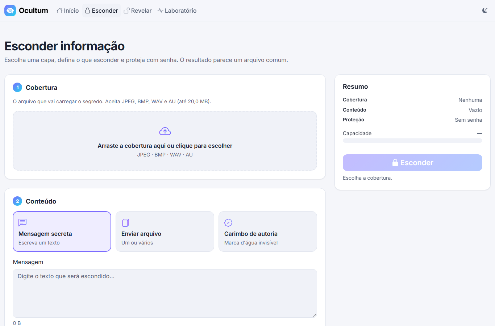
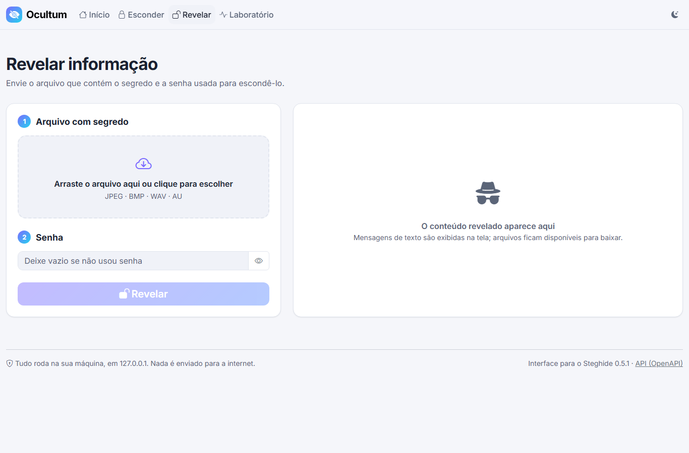
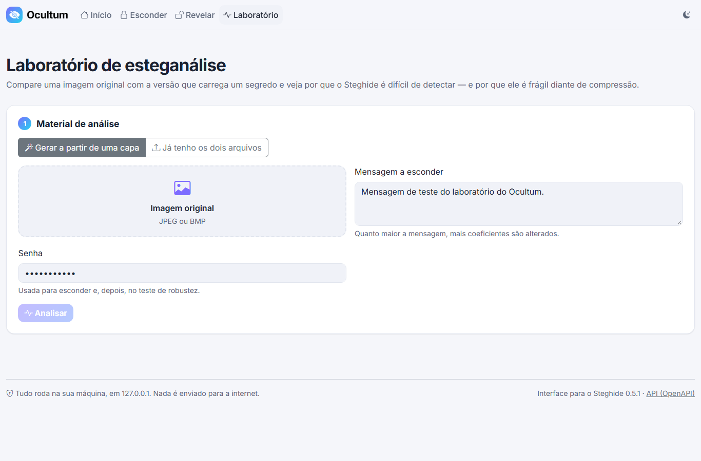

# Ocultum

Interface web em C# para o **Steghide 0.5.1**: esconda mensagens e arquivos dentro de imagens (JPEG, BMP) e áudios (WAV, AU), com senha opcional, e recupere-os depois. Trabalho de Segurança da Informação (Prof. Tiago Beloti).



## Início rápido

**Pré-requisito:** Windows 10 ou 11 (64 bits). Não é preciso instalar o .NET nem o Steghide.

1. Extraia o pacote `Ocultum-win-x64.zip` em qualquer pasta.
2. Dê **duplo clique em `Ocultum.exe`**. O navegador abre sozinho em `http://127.0.0.1:5080`.
3. Para encerrar, **feche a janela preta** do aplicativo (ou pressione `Ctrl+C` nela).

> O app escuta apenas em `127.0.0.1`: nada fica exposto na rede e nenhum arquivo sai do seu computador.

## Execução a partir do código

Requer o [.NET 10 SDK](https://dotnet.microsoft.com/download).

```bash
dotnet run --project src/Ocultum.Web
```

Abra `http://127.0.0.1:5080` (em desenvolvimento o navegador não abre sozinho).

O Steghide usado é o de `tools/steghide/` (copiado para a pasta de saída no build). Para usar outra instalação, aponte o caminho no `src/Ocultum.Web/appsettings.Development.json`, em variável de ambiente ou na linha de comando:

```bash
dotnet run --project src/Ocultum.Web -- --Steghide:ExecutablePath="C:\Ferramentas\steghide\steghide.exe"
```

Para gerar o pacote de entrega (`artifacts/Ocultum-win-x64` e o `.zip`):

```bash
powershell -ExecutionPolicy Bypass -File scripts/publish.ps1
```

## Primeiro uso em 2 minutos

A pasta `samples/` traz arquivos prontos: `cover.jpg`, `cover.bmp`, `cover.wav`, `cover.au` e `secret.txt`.

**Esconder uma mensagem**

1. Em **Esconder**, arraste `samples/cover.jpg` para a área *Cobertura*. O resumo mostra o medidor de capacidade.
2. Em *Conteúdo*, deixe **Mensagem secreta** e escreva um texto.
3. Em *Proteção*, digite uma senha (ou clique em **Gerar**) e confirme.
4. Clique em **Esconder** e depois em **Baixar arquivo**. Repita sem senha para ver o aviso de que ela é recomendada.

**Revelar com a senha certa e com a errada**

1. Vá em **Revelar** e arraste o arquivo baixado.
2. Digite uma senha **errada** e clique em *Revelar*: aparece o erro explicando que o Steghide não distingue senha errada de arquivo sem nada escondido.
3. Digite a senha **certa**: a mensagem aparece na tela, com botão de copiar.



## Guia das telas

| Tela | O que faz |
|---|---|
| **Início** (`/`) | Tela de boas-vindas: explica o projeto (esteganografia × criptografia, formatos aceitos, boas práticas e limites, como funciona) e leva às demais telas. |
| **Esconder** (`/embed`) | Três passos: *Cobertura* (JPEG, BMP, WAV ou AU), *Conteúdo* (mensagem, arquivos ou carimbo de autoria) e *Proteção* (senha e opções avançadas). O painel lateral resume tudo e mostra o medidor de capacidade. |
| **Revelar** (`/extract`) | Recebe o arquivo com segredo e a senha. Mostra mensagens na tela ou oferece o arquivo para baixar. Permite conferir o SHA-256 do conteúdo contra o original. |
| **Laboratório** (`/lab`) | Compara imagem original e imagem com segredo: histograma, entropia, PSNR, slider antes/depois, mapa de diferença e teste de robustez. |



**Campos da tela Esconder**

- **Presets:** *Mensagem secreta* (texto), *Enviar arquivo* (um ou vários; vários viram um `.zip`) e *Carimbo de autoria* (texto com autor, data e SHA-256 da cobertura original, como marca d'água).
- **Medidor de capacidade:** compara o tamanho do conteúdo com o que a cobertura comporta (informado pelo `steghide info`). Verde até 70%, amarelo acima disso, vermelho quando não cabe, e o botão fica bloqueado. Quanto mais cheio, mais fácil de detectar.
- **Senha:** opcional. Há indicador de força, botão mostrar/ocultar e gerador. Aceita letras latinas (com acentos), números e pontuação.
- **Opções avançadas:** cifra e modo (lidos do `steghide encinfo`), nível de compressão, checksum CRC32 e se o nome original do arquivo é gravado.
- **Ver comando Steghide:** no resultado, mostra o comando executado, com a senha mascarada.

**Formatos aceitos:** JPEG, BMP, WAV e AU. O formato é conferido pelos primeiros bytes do arquivo, não pela extensão. O conteúdo escondido pode ser qualquer arquivo.

## Boas práticas e limitações

- **Sem senha, qualquer pessoa com o Steghide extrai o conteúdo.** Ele fica escondido, mas não protegido.
- **Compressão destrói o segredo.** WhatsApp, redes sociais e e-mails que reduzem fotos recomprimem a imagem. Envie como documento/arquivo. O Laboratório demonstra isso.
- **Senha errada e "não há nada escondido" geram o mesmo erro** no Steghide. O app diz isso com honestidade.
- **Limite de tamanho:** 20 MB por cobertura e por conteúdo (o Steghide carrega o arquivo inteiro na memória). Configurável.
- **A senha vai na linha de comando** do processo enquanto ele roda (alguns milissegundos). O app é local e nunca registra nem guarda senhas.
- **Caracteres da senha:** o Steghide para Windows lê a linha de comando pela página de código ANSI. Caracteres fora do Latin-1 (japonês, emoji, `€`) virariam `?` e senhas diferentes se tornariam equivalentes, por isso são recusados.
- **Capacidade:** costuma ser de 1% a 10% do tamanho da cobertura.
- **Limitação do Steghide para Windows (32 bits):** ele pode travar com capas muito grandes (principalmente BMP de vários MB) combinadas a conteúdos grandes, com BMP de paleta de 8 bits malformado e com áudio incompleto. O app avisa com a mensagem *"O Steghide não conseguiu processar este arquivo"*. Prefira JPEG e mantenha o conteúdo bem abaixo da capacidade.

## API REST

Prefixo `/api/v1`. Recursos no plural, JSON em `camelCase`, uploads em `multipart/form-data`, sem HATEOAS. Erros seguem `application/problem+json` com um `errorCode` estável. O documento OpenAPI fica em [`/openapi/v1.json`](http://127.0.0.1:5080/openapi/v1.json).

| Método | Rota | Descrição | Sucesso |
|---|---|---|---|
| `POST` | `/api/v1/stego-files` | Embute dados em uma cobertura | `201` + metadados |
| `GET` | `/api/v1/stego-files/{id}/content` | Baixa o arquivo gerado | `200` binário |
| `DELETE` | `/api/v1/stego-files/{id}` | Descarta antecipadamente | `204` |
| `POST` | `/api/v1/extractions` | Extrai dados de um arquivo | `201` + metadados (e texto) |
| `GET` | `/api/v1/extractions/{id}/content` | Baixa o conteúdo extraído | `200` binário |
| `DELETE` | `/api/v1/extractions/{id}` | Descarta antecipadamente | `204` |
| `POST` | `/api/v1/cover-inspections` | Formato e capacidade de uma cobertura | `200` |
| `GET` | `/api/v1/ciphers` | Cifras e modos disponíveis | `200` |
| `POST` | `/api/v1/analyses` | Histograma, entropia, diferença e PSNR | `200` |
| `POST` | `/api/v1/robustness-tests` | Recomprime o JPEG e tenta extrair | `200` |

| Status | Quando |
|---|---|
| `400` | Campos ausentes ou inválidos |
| `404` | `id` inexistente ou expirado |
| `413` | Arquivo acima do limite |
| `415` | Formato não suportado (assinatura inválida) |
| `422` | Capacidade excedida, senha incorreta ou sem dados, conteúdo vazio, ou o Steghide não conseguiu processar o arquivo (`COVER_NOT_PROCESSABLE`) |
| `500` | Falha inesperada do Steghide (travamento conhecido vira `422`) |

**Exemplos com `curl`** (no PowerShell use `curl.exe`; as barras `\` abaixo são do Bash, no PowerShell troque por crases ou escreva em uma linha):

```bash
# Esconder uma mensagem em samples/cover.jpg
curl -X POST http://127.0.0.1:5080/api/v1/stego-files \
  -F "cover=@samples/cover.jpg" \
  -F "message=Encontro às 20h" \
  -F "passphrase=minha-senha"
# → {"id":"0f6c1d0e…","fileName":"cover-stego.jpg","sizeBytes":…,"sha256":"…","isPasswordProtected":true,…}

# Baixar o resultado
curl -o segredo.jpg http://127.0.0.1:5080/api/v1/stego-files/0f6c1d0e…/content

# Revelar
curl -X POST http://127.0.0.1:5080/api/v1/extractions \
  -F "stegoFile=@segredo.jpg" \
  -F "passphrase=minha-senha"
# → {"id":"5a2f…","kind":"text","text":"Encontro às 20h",…}

# Quanto cabe em uma cobertura?
curl -X POST http://127.0.0.1:5080/api/v1/cover-inspections -F "cover=@samples/cover.wav"
```

Campos de `POST /stego-files`: `cover` (obrigatório), `message` **ou** `payloadFile` (repetível), `passphrase`, `encryption` (ex.: `twofish ofb` ou `none`), `compressionLevel` (0 a 9), `embedChecksum`, `embedFileName`.

Exemplo de erro `422`:

```json
{
  "status": 422,
  "title": "Not enough capacity in the cover file.",
  "detail": "Payload is 5.2 KB but the cover holds 3.5 KB.",
  "errorCode": "CAPACITY_EXCEEDED"
}
```

## Configuração

Em `appsettings.json`, na pasta do `Ocultum.exe`. Qualquer opção também pode vir de variável de ambiente (`Server__Port=5090`) ou da linha de comando (`--Server:Port=5090`).

| Opção | Padrão | Descrição |
|---|---|---|
| `Server:Port` | `5080` | Porta de partida. |
| `Server:PortSearchRange` | `20` | Se a porta estiver ocupada, tenta as próximas até esse limite. |
| `Server:OpenBrowser` | `true` | Abre o navegador ao iniciar. |
| `Steghide:ExecutablePath` | `tools/steghide/steghide.exe` | Caminho do Steghide (relativo à pasta do app, ou absoluto). |
| `Steghide:TimeoutSeconds` | `60` | Tempo máximo de uma execução do Steghide. |
| `Steghide:MaxConcurrency` | `2` | Quantos processos do Steghide rodam ao mesmo tempo. |
| `Workspace:RootPath` | *(vazio)* | Pasta dos arquivos temporários. Vazio usa `%TEMP%\Ocultum`. |
| `Workspace:TtlMinutes` | `30` | Por quanto tempo um resultado fica disponível para download. |
| `Workspace:CleanupIntervalMinutes` | `5` | Intervalo da limpeza automática. |
| `Limits:MaxCoverBytes` | `20971520` | Tamanho máximo de uma cobertura (20 MB). |
| `Limits:MaxPayloadBytes` | `20971520` | Tamanho máximo do conteúdo a esconder (20 MB). |
| `Limits:MaxPayloadFiles` | `20` | Máximo de arquivos por operação. |
| `Limits:MaxPassphraseLength` | `128` | Tamanho máximo da senha. |

## Solução de problemas

| Sintoma | O que fazer |
|---|---|
| **Porta ocupada** | O app procura sozinho a próxima porta livre e mostra o endereço na janela. Para fixar outra, use `Server:Port`. |
| **"O Steghide não foi encontrado"** | Confirme que a pasta `tools/steghide/` (com `steghide.exe` e as DLLs `cyg*.dll`) está ao lado do `Ocultum.exe`, ou ajuste `Steghide:ExecutablePath`. |
| **Antivírus bloqueia ou apaga arquivos** | O Steghide usa DLLs do Cygwin, e alguns antivírus desconfiam delas. Adicione a pasta do Ocultum às exceções e extraia o zip de novo. |
| **Janela do navegador não abre** | Abra manualmente o endereço mostrado na janela do aplicativo. |
| **"O Steghide não conseguiu processar este arquivo"** | Limitação do próprio Steghide. Use um JPEG, uma imagem menor ou reduza o conteúdo. |
| **Arquivo rejeitado** | Verifique o formato (JPEG, BMP, WAV ou AU de verdade, não só a extensão) e o medidor de capacidade. |
| **"Não foi possível revelar nada"** | Senha incorreta, arquivo sem segredo ou imagem recomprimida (por exemplo, enviada por WhatsApp). |
| **Senha recusada** | Use só letras latinas (acentos são aceitos), números e pontuação comum. |
| **Arquivo expirou** | Os resultados ficam disponíveis por 30 minutos (`Workspace:TtlMinutes`). Gere de novo. |

## Testes

```bash
dotnet test
```

São 100+ testes (xUnit + FluentAssertions):

- **Unitários:** leitura de assinatura de arquivo, sanitização de nomes, validação de senha, *parser* e mapeador de erros do Steghide (com saídas reais capturadas), expiração do workspace, busca de porta.
- **Integração (exigem o `steghide.exe` real, ou seja, Windows):** ida e volta em JPEG/BMP/WAV/AU com e sem senha, senha errada, capacidade excedida, formato falso, texto Unicode, vários arquivos em zip, nome embutido malicioso, esteganálise e robustez.
- **API:** códigos de status, formato `problem+json`, ausência de links, proteção contra Host/Origin indevidos e OpenAPI.

Em outros sistemas operacionais os testes que dependem do Steghide são ignorados.

## Estrutura do projeto

```
Ocultum/
├── src/
│   ├── Ocultum.Core/             domínio, contratos e serviços de aplicação (sem I/O direto)
│   ├── Ocultum.Infrastructure/   SteghideClient, parser e mapeador de erros, workspace temporário, análise de imagem
│   └── Ocultum.Web/              API REST, páginas MVC, wwwroot (JS em módulos ES), Program.cs
├── tests/Ocultum.Tests/
├── tools/steghide/               Steghide 0.5.1 para Windows (com copying.txt e credits.txt)
├── samples/                      arquivos de exemplo
├── scripts/publish.ps1           gera o pacote de entrega
└── Ocultum-Plan.md               planejamento original
```

- **Core** não conhece processos nem disco: fala com `ISteghideClient`, `ITemporaryWorkspace` e `IImageAnalyzer`.
- **Infrastructure** executa o `steghide.exe` com `ArgumentList`, `LANG=C`, timeout e semáforo de concorrência; cada operação usa uma pasta temporária própria, com arquivos de nome simples.
- **Web** valida a entrada, chama o serviço e devolve o resultado; não tem regra de negócio.

### Escopo desta versão

O **Histórico** (prioridade P2 do planejamento, que dependia de SQLite) foi **adiado**: não há banco de dados, e as rotas `/api/v1/operations` e a tela `/history` não existem ainda. O "LSB ingênuo" com teste qui-quadrado (stretch do laboratório) também ficou de fora.

## Créditos e licenças

- **[Steghide](https://steghide.sourceforge.net/)** 0.5.1, de Stefan Hetzl, sob licença **GPL**. O executável para Windows (build Cygwin) está em `tools/steghide/`, acompanhado de `copying.txt` e `credits.txt`. O código-fonte está disponível no site do projeto.
- [Bootstrap](https://getbootstrap.com/) 5.3 e [Bootstrap Icons](https://icons.getbootstrap.com/) (MIT), [Chart.js](https://www.chartjs.org/) 4 (MIT), fonte [Inter](https://rsms.me/inter/) (OFL), [SkiaSharp](https://github.com/mono/SkiaSharp) (MIT). Versões e arquivos em `src/Ocultum.Web/wwwroot/lib/README.md`.
- Trabalho da disciplina de Segurança da Informação (Prof. Tiago Beloti, N2).
